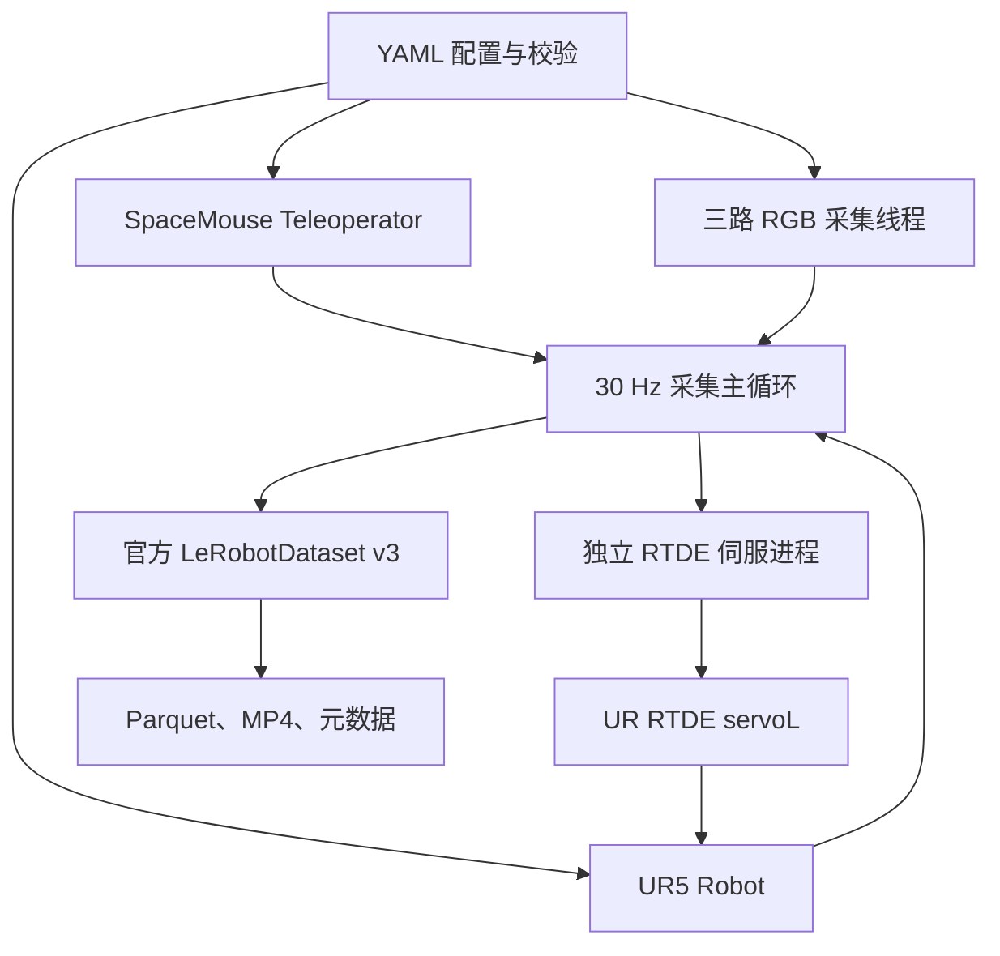

# UR5 · SpaceMouse · 三视角 RGB · LeRobot v3

配置驱动的单 UR5 / 单 SpaceMouse / 三路 RealSense RGB 示教采集（2 个全局视角、1 个 eye-in-hand）。

**数据维度（当前版本）：**

- `observation.state: float32[8]`：绝对 EEF TCP `[x,y,z,rx,ry,rz]` (6D) + 夹爪左右手指**绝对关节位置** `[left_finger_qpos_m,right_finger_qpos_m]` (2D)。前三维单位米、姿态为旋转向量（轴角）rad、夹爪位置单位米；不是关节角或 8D 增量。
- `action: float32[7]`：`[dx,dy,dz,drx,dry,drz,grasp]`；6D EEF 相对**控制目标增量**，以及 1D 二值夹爪命令 (0=open, 1=closed)。与上一时刻真实位姿之差可能不同。
- `observation.joint_positions: float32[6]`：单独保存 UR5 六个关节角。

原压缩包自带的 `datasets/mock_three_rgb/` 是**历史 6D state / 6D action** 示例，已保留以免丢失数据；新模拟配置使用 `datasets/mock_three_rgb_8d/`，避免把旧样本当作本次 8D/7D 数据。

**RG2 夹爪：** 当前实机链路使用 UR5 RTDE 寄存器读写，最大开合度 **110 mm**。`grasp=0` 目标张开，`grasp=1` 目标闭合；设置 `gripper.actuation_enabled: true` 后，目标切换时下发夹爪命令。SpaceMouse 按键 0 与终端 `g` 都会切换目标。RTDE worker 回报的目标总开度 `w` 派生为 `[w/2,-w/2]`（米）；该旧式工具 I/O 链路不提供独立编码器测量。参见 [RG2 接入说明](docs/RG2.md) 和 [反馈接口](docs/GRIPPER_FEEDBACK.md)。

LeRobot 0.6.2 官方 writer 负责生成 v3.0；LeRobot v0.3.3 隔离环境负责 v2.1↔v3.0 格式转换。当前仅采 RGB、非 RGB-D；未做实物硬件验证。

## 1. 架构与目录



| 路径 | 职责 |
|---|---|
| `lerobot/` | 官方 LeRobot 0.6.2 Git 子模块；已整合外部 lerobot-rerun 的固定提交 |
| `compat/lerobot_v21/` | 官方 v0.3.3 源码快照，供隔离转换环境使用 |
| `configs/ur5_three_rgb.yaml` | 实机配置；使用 UR RTDE 和 RTDE 寄存器 RG2 |
| `configs/mock.yaml` | 不依赖实物的三视角演示配置 |
| `src/ur5_capture/lerobot_bridge.py` | 继承官方 `Robot` / `Teleoperator` 的适配类 |
| `src/ur5_capture/robot.py` | UR RTDE 独立进程、限位和超时停止 |
| `src/ur5_capture/teleop.py` | SpaceMouse 原始 HID 输入、轴映射、夹爪与速度档按键 |
| `src/ur5_capture/gripper.py` | 8D 状态的两指反馈接口；模拟模式和硬件插件模式 |
| `src/ur5_capture/rg2.py` | RG2 Modbus/UR RTDE 驱动；110 mm 开度、后台状态与执行 |
| `src/ur5_capture/cameras.py` | 三台 RealSense 并行 RGB 读取、时间选择、重复帧检测 |
| `src/ur5_capture/dataset.py` | 特征定义与官方 v3 写入器 |
| `src/ur5_capture/record.py` | episode 开始、结束、保存、丢弃、异常清理 |
| `src/ur5_capture/replay.py` | `ur5-replay` 本地数据集视频/action/state 同步可视化与 RRD 导出 |
| `src/ur5_capture/convert.py` | 两个 Python 环境之间的双向转换调度 |
| `src/ur5_capture/conversion_worker.py` | 官方读写器转换及逐帧校验 |
| `tools/inspect_dataset.py` | 解码全部视频并检查动作定义和时间连续性 |
| `docs/ARCHITECTURE.md` | 数据语义、时序和扩展边界 |
| `docs/VALIDATION.md` | 已执行验证、结果与实机待验项 |
| `docs/GRIPPER_FEEDBACK.md` | 真实夹爪关节位置采集接口和示例 |
| `docs/RERUN.md` | Rerun 环境安装、桌面/浏览器回放和 RRD 导出 |

**LeRobot 软件版本与数据版本不同。** 本项目固定 LeRobot **0.6.2 → 数据 v3.0**，兼容环境固定 LeRobot **v0.3.3 → 数据 v2.1**。源码 commit 见 `UPSTREAM.json`。扩展代码位于独立包中，没有修改官方源码。

采集器调用官方基类的扩展接口以保留时间戳及控制命令确认；相机由 `CameraRig` 管理。当前入口为 `ur5-capture`，不是直接调用上游 `lerobot-record`。配置类型会在导入适配模块后注册，但没有修改上游 CLI 的设备发现和 processor 工厂。

## 2. 手动 Conda 环境安装（不使用一键安装脚本）

在 **项目根目录** 下逐行执行。v3 采集与回放环境使用 Python 3.12（匹配当前 LeRobot），使用 conda-forge 通道。请避免 `conda create -n xxx python= 3.12` 中 `=` 后面的空格。建议 Linux x86_64 + RealSense SDK + RTDE 用于实机；macOS 可用于离线开发，但 macOS 的 RealSense SDK/USB 兼容性不在已验范围内。首次下载依赖需要联网。

### 2.1 v3 采集环境

```bash
# 1. 创建并进入 Conda 环境（不是 venv）
conda create -n ur5-lerobot-v3 -c conda-forge python=3.12 -y
conda activate ur5-lerobot-v3

# 2. 安装系统级视频编解码工具和固定的项目依赖
conda install -c conda-forge ffmpeg -y
python -m pip install --upgrade pip
python -m pip install -r requirements/v3.txt
python -m pip install -e .

# 3. 使用本项目内的官方 LeRobot 源码，不自动拉取新版 LeRobot
git submodule update --init --recursive
git -C lerobot checkout --detach 326484d77d2ac90379e84222dfad21fe4acf1f71
python -m pip install -e ./lerobot --no-deps
python -m pip install -e '.[test]'

# 4. 核验解释器、版本与本项目配置
python -c 'import sys; print(sys.executable)'
python src/ur5_capture/conversion_worker.py probe --version v3.0
ur5-capture validate --config configs/mock.yaml
python -m pytest tests -q
```

Linux CPU-only 开发机如需避免 pip 默认获取 GPU 版 PyTorch，可以**在安装 `requirements/v3.txt` 之前**先执行：

```bash
python -m pip install torch==2.7.1 torchvision==0.22.1 --index-url https://download.pytorch.org/whl/cpu
```

**模拟采集和检查（每次运行自动创建带递增编号的新数据集目录）：**

```bash
conda activate ur5-lerobot-v3
ur5-capture record --config configs/mock.yaml --unattended
python tools/inspect_dataset.py --root datasets/mock_three_rgb_8d_0000
```

该 Conda 环境为采集、转换和 Rerun 回放提供所需依赖，**不是**全部上游算法训练环境；上游全部训练、仿真等可选 extras 需要按上游文档单独安装。LeRobot 的 `--no-deps` 安装是为了避免覆盖本项目固定测试的依赖版本。

**同步回放三路视频、action 和 state：**

```bash
ur5-replay --root datasets/ur5_three_rgb_0003 --episode-index 0
```

替换为实际保存的数据集目录。依赖已包含在 `requirements/v3.txt`；详细安装、导出 `.rrd`、
浏览器及远程查看方法见 [Rerun 回放说明](docs/RERUN.md)。

### 2.2 v2.1 数据转换环境

```bash
# 与 v3 环境隔离，避免两个版本的 datasets/LeRobot 互相覆盖
conda create -n ur5-lerobot-v21 -c conda-forge python=3.11 -y
conda activate ur5-lerobot-v21
conda install -c conda-forge ffmpeg -y
python -m pip install --upgrade pip
python -m pip install -r requirements/v21.txt
python -m pip install -e ./compat/lerobot_v21 --no-deps
python src/ur5_capture/conversion_worker.py probe --version v2.1

# 返回 v3 环境执行采集或转换调度
conda activate ur5-lerobot-v3
```

如需同时存在多个环境，请使用 `conda run -n ... python -c 'import sys; print(sys.executable)'` 查询两个解释器的**绝对路径**，再将其传给转换命令；不要依赖当前激活的 Python 误读另一个版本。

## 3. 实机配置与采集

安装硬件 Python 依赖：

```bash
conda activate ur5-lerobot-v3
python -m pip install -e '.[hardware]'
# Ubuntu / Debian：easyhid 需要 hidraw 后端；仅安装 Python hidapi 包或 libusb 后端不够
sudo apt-get install libhidapi-hidraw0
ur5-capture devices
```

RealSense 还需要匹配的系统 SDK/USB 设备权限；SpaceMouse 使用 PySpaceMouse 2.0 的原始 HID 接口，需要 hidapi 系统库及 hidraw 访问权限。依照设备官方安装说明配置，避免其他 SpaceMouse 驱动独占设备。

**实时预览三个相机：**

```bash
# requirements/common.txt 默认安装 headless 版；窗口预览需切换为桌面版 OpenCV
python -m pip uninstall -y opencv-python-headless
python -m pip install -e '.[preview,hardware]'
python -m pip install --force-reinstall --no-deps 'opencv-python>=4.10,<5'
python -m ur5_capture.preview --config configs/ur5_three_rgb.yaml
# 无相机时测试窗口
python -m ur5_capture.preview --mock
```

也可以使用 `ur5-preview` 命令。三路 RGB 画面按配置顺序并排显示，标注名称、序列号、
分辨率和帧龄；过期帧显示红色 `STALE`。预览独立读取每路最新帧，不强制三路同步。
按 `Q`、`Esc`、关闭窗口或 `Ctrl+C` 退出。`--tile-width 640` 调整每路显示宽度，
`--duration 10` 限时运行；无桌面时可用 `--headless --duration 5` 检查采集与渲染链路。
脚本只连接相机，不连接机械臂、夹爪或 SpaceMouse，也不保存数据。预览前请退出其他占用相机的采集程序。

若出现 `undefined symbol: hid_enumerate` 或 `HID API is probably not installed`，先安装上述 `libhidapi-hidraw0`，再重试。可在采集环境运行 `python -c 'from ctypes.util import find_library; print(find_library("hidapi-hidraw"))'`，应返回 `libhidapi-hidraw.so.0`。若能列出设备但无法打开，再检查 hidraw 的 udev 权限。

编辑 `configs/ur5_three_rgb.yaml`：

| 配置 | 必须确认的内容 |
|---|---|
| `robot.ip` | UR5 控制器地址；主机与机器人网络可达 |
| `robot.controller` | 普通 UR5 设 `cb3`，UR5e 才设 `e_series` |
| `robot.motion_backend` | 固定使用 `ur_rtde`；示教器加载兼容 `ur_rtde` 的 External Control URCap |
| `robot.ur_cap_port` | External Control URCap 服务端口；必须与 YAML 一致，默认 `50005` |
| `robot.control_hz` | 默认 125；CB3 配置禁止超过 125 |
| `robot.tcp_offset` | 实测工具相对法兰偏移，单位 m、旋转向量 rad |
| `robot.tcp_configured` | 完成 TCP 配置后改为 true |
| `robot.workspace_min/max` | 实际允许的 TCP 工作区域；示例值不是你的安全边界 |
| `robot.workspace_configured` | 核实工作区后改为 true |
| `cameras[].serial` | 三台相机各自唯一序列号，以字符串填写 |
| `teleop.translation_axes/rotation_axes` | 确认实际 SpaceMouse 各轴方向 |
| `teleop.*_signs` | 对需要反向的轴填 -1 |
| `teleop.frame` | `base` 或 `tool`；最终保存的动作统一为 base 坐标 |
| `gripper.initial_grasp` | 初始目标，0=张开，1=闭合；连接时不移动 |
| `gripper.toggle_button` | SpaceMouse 夹爪切换键索引；当前配置为按键 0，终端 `g` 也可切换 |
| `teleop.speed_toggle_button` | SpaceMouse 速度档切换键索引；当前配置为按键 1 |
| `teleop.low_speed_ratio/high_speed_ratio` | 低速/高速档映射比例（0 < 低速 ≤ 高速 ≤ 2）；SpaceMouse 满偏时末端速度 = 比例 × 0.4 m/s（平移）及比例 × 1.0 rad/s（旋转），比例 2 对应 0.8 m/s、2.0 rad/s，按键 1 切换 |
| `gripper.feedback_source` | 实机固定 `plugin`，模拟模式固定 `mock` |
| `gripper.feedback_plugin` | RG2 使用 `ur5_capture.rg2:RTDEGripper`；其他型号可使用兼容插件 |
| `gripper.feedback_kwargs` | RG2 填写 UR5 `robot_ip`、RTDE `port`、寄存器映射、开闭宽度和夹持力 |
| `gripper.actuation_enabled` | 默认 false；启用后，夹爪目标切换时下发执行命令 |
| `robot.motion_enabled` | 完成以上配置后设 true |
| `dataset.root/task/episodes/episode_seconds` | 输出目录、任务描述及采集长度 |

`dataset.root` 是目录名前缀。每次执行 `record` 都创建一个新数据集，例如
`datasets/ur5_three_rgb_0000`、`datasets/ur5_three_rgb_0001`；编号从已有最大编号继续递增，
旧的无编号目录也会保留。一次运行中的多个 episode 保存在同一个数据集中。
启动时的 `Dataset output:` 和结束时返回的 `root` 均为本次实际保存路径。

机械臂应已完成启动、制动器释放、工具负载设置，处于允许远程 RTDE 控制的状态；本项目不自动开机、解锁保护停机或执行回零。不同 UR5 控制器/PolyScope 版本的远程模式需按设备说明设置。

当前实机配置直接使用 `ur_rtde` 控制机械臂。不要启动 ROS `ur_robot_driver`，否则会占用默认 External Control 端口。示教器加载兼容 `ur_rtde` 的 External Control URCap 程序，并把服务端口设为 YAML 中的 `robot.ur_cap_port`（默认 `50005`），确认机器人处于 RUNNING 状态。

另一个终端再执行采集命令。示教器必须加载包含 RG2 worker 线程的 `external_control_rg2.urp`；否则 RG2 RTDE 寄存器能连接但不会 ack。

采集进程里的 `RTDEGripper` 独占 RTDE 寄存器 24--28；不要同时运行其他 RTDE register client，否则会争抢同一组 input registers。

```bash
ur5-capture validate --config configs/ur5_three_rgb.yaml
ur5-capture record --config configs/ur5_three_rgb.yaml
```

**采集 Episode 时同时查看三路图像：**

```bash
ur5-capture record --config configs/ur5_three_rgb.yaml --preview
# 可选：调整每路预览宽度，默认 480 像素
ur5-capture record --config configs/ur5_three_rgb.yaml --preview --preview-tile-width 640
```

需要前面相机预览步骤中的桌面版 OpenCV 和桌面显示环境。采集时无需另外运行
`ur5-preview`；窗口复用实际写入 Episode 的三路同步 RGB 帧，显示名称、序列号和帧龄。
显示由独立进程处理，最多刷新 15 次/秒；预览来不及时跳过显示帧，数据仍按配置帧率采集，
保存的原始图像不会被缩放或添加文字。相机连接后，即使机械臂仍在连接、等待开始或编码保存，
也会显示相机最新图像，此时标记为 `PAUSED`，表示尚未录制；只有录制期间显示 `RECORDING`。
窗口内 `Q`、`Esc` 或关闭窗口仅关闭预览，采集继续；
开始、夹爪切换、结束、丢弃、退出等操作仍使用采集终端和 SpaceMouse。
不带 `--preview` 时保持原来的无窗口采集方式。

交互方式：

1. Enter 开始 episode；无需按 SpaceMouse 按键 0。
2. SpaceMouse 摇杆轴直接控制机械臂。按键 0 按下沿切换 `grasp` 指令（0 张开、1 闭合）；终端 `g` 效果相同。
3. 按键 1 按下沿切换低速/高速档。低速档默认 `0.05 m/s、0.3 rad/s`，高速档默认 `0.15 m/s、0.8 rad/s`。
4. 终端 `s` 提前结束 episode；`d` 丢弃；`q` 丢弃当前 episode 并退出。结束后 Enter/`s` 保存，`d` 重录，`q` 丢弃并退出。
5. Ctrl-C 中断采集；当前未完成 episode 丢弃，已经完成的保留。紧急情况使用示教器实体急停。

每个 episode 开始时丢弃保存、等待期间积累的 SpaceMouse 输入和按键事件，保留夹爪目标及速度档。
开始后先松开摇杆再重新操作；收到新的 HID 事件前不发送运动。录制中非零输入超过
`teleop.stale_timeout_s` 未更新仍会停止并报错，以防持续重放旧运动指令。

按键 0 和 1 都是按下沿触发，按住不会重复切换。夹爪执行还要求 `gripper.actuation_enabled: true`；关闭时只记录目标，不驱动物理夹爪。结束 episode、异常或退出时会停止软件伺服并取消尚未发送的夹爪目标，不自动张开放开物体。RTDE worker 没有独立停止寄存器，已发送的 RG2 命令由 worker 完成。**8D 状态不能当作独立编码器测量。**

开始实机联调时先在空旷区域用低速核对单轴方向、TCP、速度档、失联与断帧停止行为。软件停止和 TCP 盒状限位不能代替物理急停，也不做碰撞规划或完整机械臂几何限位检查。Python 伺服进程不提供硬实时保证。

## 4. 数据定义

| 字段 | 维度/格式 | 含义 |
|---|---|---|
| `observation.images.agentview_1` | H×W×3，RGB uint8 输入 | 全局视角 1，存 MP4 |
| `observation.images.agentview_2` | H×W×3，RGB uint8 输入 | 全局视角 2，存 MP4 |
| `observation.images.eye_in_hand` | H×W×3，RGB uint8 输入 | 手眼相机，存 MP4 |
| `observation.state` | **float32[8]** | 绝对 `[x,y,z,rx,ry,rz,left_finger_qpos_m,right_finger_qpos_m]`；前 6D 是实测 TCP，后 2D 为插件反馈或 mock 模拟反馈；RTDE RG2 后 2D 为 worker 回报目标宽度 |
| `action` | **float32[7]** | `[dx,dy,dz,drx,dry,drz,grasp]`；前六维为本周期目标 TCP 增量，第七维为二值夹爪指令状态（0 张开，1 闭合） |
| `observation.joint_positions` | float32[6] | 六关节位置，rad，作为附加观测 |
| `complementary_info.target_pose` | float32[6] | 裁剪后提交且被控制进程接收的 TCP 目标 |
| `complementary_info.camera_frame_numbers` | int64[3] | 相机硬件帧号，顺序与 config 一致 |
| `complementary_info.camera_host_times` | float64[3] | 三路帧到达主机的 monotonic 秒 |
| `complementary_info.camera_device_times_ms` | float64[3] | 各自设备时间，不假定具有共同起点 |
| `complementary_info.robot_timestamp` | float64[1] | 控制器时间，秒 |
| `complementary_info.gripper_host_time` | float64[1] | 夹爪反馈样本完成的主机 monotonic 秒；RTDE RG2 为 worker 状态报文时间 |
| `complementary_info.robot_host_time` | float64[1] | 控制进程读取状态时的主机时间 |
| `complementary_info.host_time` | float64[1] | 主循环组装记录时的主机时间 |
| `complementary_info.command_accepted_time` | float64[1] | 控制进程接受目标命令时的主机时间 |
| `complementary_info.motion_enabled` | int64[1] | 本帧运动使能状态 |

位置单位 m；姿态是旋转向量（轴角），**不是欧拉角**。旋转增量满足 `R_target = Exp(dr) @ R_observed`。输入设为 tool 坐标时先正确进行旋转复合，再把最终动作转换为 base 坐标保存。

夹爪指令使用锁存状态，不是夹爪增量，也不是实测开度。`observation.state[6:8]` 则是左右指的**绝对位置**（单位 m），从单独的夹爪反馈对象读取，**不是** `action[6]` 的复制或变换；mock 使用模拟反馈。`complementary_info.motion_enabled` 单独保存本帧运动使能；它不属于 7 维动作。LeRobot Robot/Teleoperator 直连控制接口另有一个 `enabled` 字段，但 SpaceMouse 不再使用 deadman 按键。

每行表达：先获取 `observation_t`（含 EEF 与夹爪反馈），再提交 `action_t`，目标在一个 `1/fps` 周期内插值逼近。`action` 是目标命令增量，**不等于实测 `state[t+1] - state[t]`**，也不是机器人内部实际已执行位移。`target_pose` 是目标端点，不是 125 Hz 的每个内部插值设定点。

`timestamp`、`frame_index`、`episode_index`、`index`、`task_index` 由官方写入器生成。标准 `timestamp=frame_index/fps`，实测墙钟偏差保存在附加字段。训练加载器默认将图像转换为 CHW、float32、[0,1]。部分数值特征在官方默认 tensor transform 中也可能转成 float32；需要 float64 时间精度时应读取 Parquet 原值，本项目转换工具已这样处理。

三个独立 RGB 传感器使用主机到达时间做软件选择；每帧必须比上一条记录更新，且通过 freshness 与 skew 阈值。**这不是三相机曝光级硬件同步**，设备时间戳不直接跨相机相减。运动速度高、需要精确几何重建时，应另行建立设备时钟映射、曝光同步和手眼/外参标定。本项目保存相机内参，不自动完成外参标定。

## 5. v2.1 与 v3.0 双向转换

先按 §2 **手动创建两个 Conda 环境**，然后在项目根目录执行：

```bash
# 查询两个 Conda 环境的实际 Python 路径
V3_PY="$(conda run -n ur5-lerobot-v3 python -c 'import sys; print(sys.executable)')"
V21_PY="$(conda run -n ur5-lerobot-v21 python -c 'import sys; print(sys.executable)')"
conda activate ur5-lerobot-v3

# v3 -> v2.1
ur5-convert \
  --source datasets/mock_three_rgb_8d \
  --destination datasets/mock_v21 \
  --python-v21 "$V21_PY" \
  --python-v3 "$V3_PY"

# v2.1 -> v3
ur5-convert \
  --source datasets/mock_v21 \
  --destination datasets/mock_v3_roundtrip \
  --python-v21 "$V21_PY" \
  --python-v3 "$V3_PY"
```

两个版本都会保留 `observation.state: 8D` 和 `action: 7D` 的特征形状；转换器保留数值字段但会重新编码视频。

工具根据源 `meta/info.json` 自动确定方向。官方源读取器解析 episode / 视频偏移，导出临时无损 NPZ 桥接数据；另一环境的官方写入器重建数据和统计量。最后逐帧核验数值、任务、时间戳及图像尺寸，成功后才将临时输出改名为正式目录。源目录从不修改，不覆盖既有目标目录，不上传到 Hub。

转换保留每帧数值字段、episode 顺序、任务文本和时间戳；任务索引可能重新编号。MP4 会重新编码：**不是像素无损或文件字节无损转换**。报告 `meta/conversion_validation.json` 给出每个视角的解码后平均绝对像素误差。v2.1 使用该版本官方默认 AV1 编码；v3 使用 H.264。若目标是大规模、保持视频压缩码流的 v2.1→v3 迁移，可另外使用根目录源码里的官方单向迁移脚本。

转换范围是本项目数据，以及 HWC 三通道 RGB image/video + 固定形状数值特征的连续 episode 数据集。复杂字符串特征、subtask 元数据、外部自定义附件不在通用转换范围内；unsupported schema 会报错。会复制本项目 `capture_config.json` 和 `environment.txt`，不会承诺保留其他项目的自定义元数据。

临时解码 RGB 数据可能远大于 MP4；可用 `--work-parent /path/with/free/space` 指定临时目录。转换失败留下带 `CONVERSION_FAILED.txt` 的临时输出用于检查，不会伪装成完成的数据集。

## 6. 官方参考

- [LeRobotDataset v3 文档](https://huggingface.co/docs/lerobot/lerobot-dataset-v3)
- [当前 LeRobot 固定源码](https://github.com/huggingface/lerobot/tree/326484d77d2ac90379e84222dfad21fe4acf1f71)
- [Rerun](https://github.com/rerun-io/rerun)
- [LeRobot v0.3.3 源码](https://github.com/huggingface/lerobot/tree/b883328e6c95681ca90a18b102e4ae5e1f91e2bf)
- [ur_rtde servoL 示例](https://sdurobotics.gitlab.io/ur_rtde/pages/examples/high_frequency_servoing/servol_example.html)
- [PySpaceMouse](https://github.com/JakubAndrysek/PySpaceMouse)
- [RealSense SDK](https://github.com/realsenseai/librealsense)
